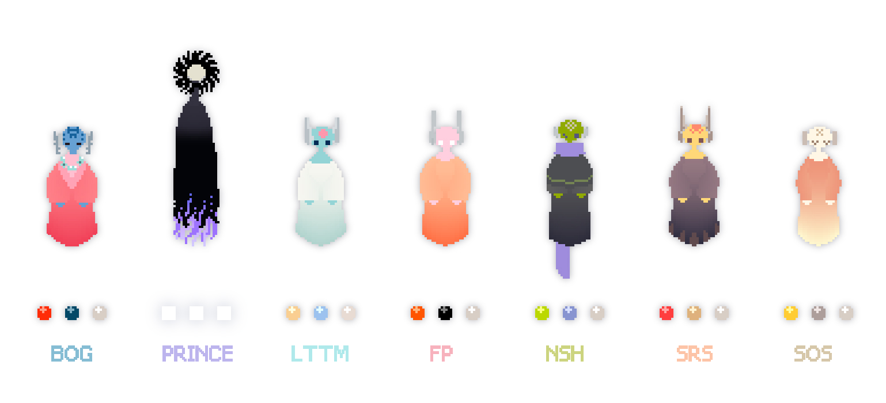

# 迭代器桌宠 / rw iterator pet



**未完成，可能存在各种bug和性能问题**

**This project is unfinished and may have bugs and performance issues.**

如果您希望直接获取桌宠游玩，请直接下载`gesture_pet_xx.zip`，将exe和presets解压至同一目录下，勿下载source code.zip

If you just want to play this desktop pet, please download the `gesture_pet_xx.zip`(not the source code.zip!!!) and unzip the .exe and presets to the same dir.

---

此桌宠运行需要本机已安装雨世界本体，桌宠将从其中读取部分游戏资源并引用

（如果您有downpour/watcher dlc/猎手拓展mod，将有部分依赖dlc资源的扩展选项可用

A local installation of the Rain World base game is required to load the original textures.

If you have Downpour/The Watcher DLC/Hunter Expansion mod, some extra options will be available.   

---

以调试方式启动：

To launch in debug mode:

```powershell
python run_pet.py --creature oracle
```

## 资源与版权说明 / Copyright

- 本项目为雨世界非官方粉丝作品，项目及其衍生版本均禁止用于任何商业活动
- 原作名称、角色与素材归各自权利人所有；第三方代码及组件保留原有许可
- 本仓库不分发游戏素材，所需资源从使用者本机的正版游戏中读取或提取，仅供本地运行，未经许可勿再次分发；本项目不授予任何原作素材相关权利


- This is an unofficial Rain World fan project. Commercial use of this project and any derivative versions is prohibited.
- The original game's names, characters, and assets belong to their respective rights holders. Third-party code and components retain their original licenses.
- This repository does not distribute game assets. Required resources are read or extracted from the user's legally obtained local copy of the game for local use only. Do not redistribute them without permission. This project grants no rights to the original game's assets.

## 参考 / References

此桌宠实现过程中参考了以下工程，非常感谢！

The following projects were used as references while developing this desktop pet. Many thanks to their authors!

- 鼠标拖动mod [woutkolkman / MouseDrag](https://github.com/woutkolkman/mousedrag)
- 蛞蝓猫桌宠 [lingxiaojun / SlugcatPet](https://github.com/lingxiaojun/slugcatpet)

## 相关项目 / Related Projects

另一位开发者制作的坨坨桌宠，喜欢蜥蜴的朋友可以看看这个！

A lizor pet by another itera...developer. Lizard lovers, check it out!

- 青蜥蜴桌宠 [ErraticPu1se / cyan-lizor](https://github.com/ErraticPu1se/cyan-lizor)


